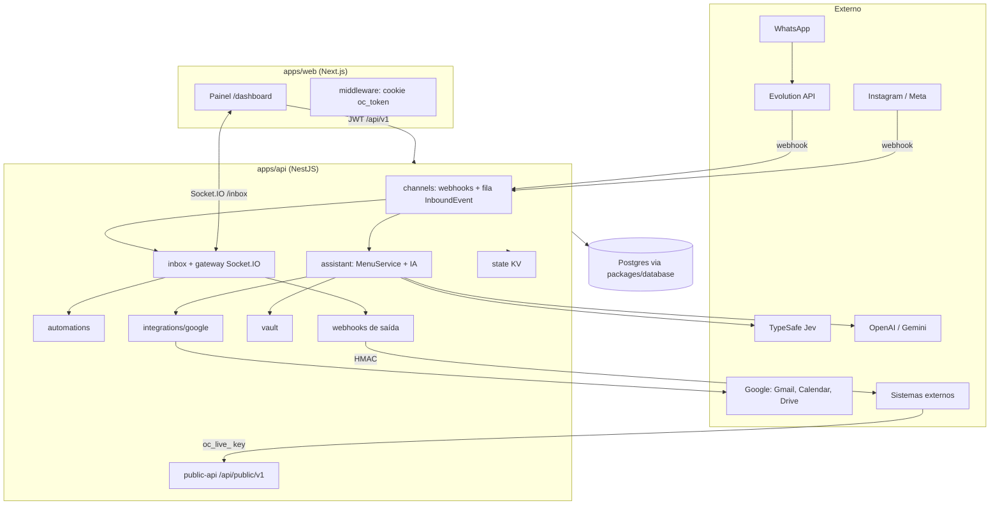
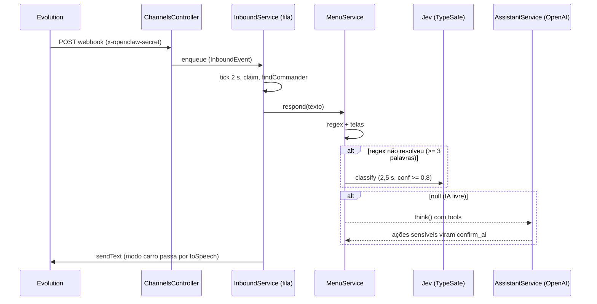

# Codebase Map

> Gerado pelo Cartographer. Último mapeamento: 2026-09-30T15:49:57Z.
> Produto: **Assist.IA** (repositório `openclaw`). Comentários, mensagens e logs do código estão em pt-BR.

## Visão geral do sistema

Monorepo pnpm 12.6 + Turborepo: API NestJS 10, painel Next.js 15 (React 19, Tailwind 3), Prisma 6 sobre Postgres. O sistema recebe mensagens de WhatsApp (via Evolution API) e Instagram, guarda tudo em um inbox multi-tenant e oferece um assistente pessoal por WhatsApp (e-mail, agenda, Drive, notas, cofre de senhas, clima). Estado, filas e cache ficam no Postgres (`KvEntry`, `InboundEvent`, `WebhookDelivery`); não há Redis em uso.



## Estrutura de diretórios

```
openclaw/
├── apps/
│   ├── api/                 NestJS (src/ 92 arquivos, test/ 27 specs)
│   │   └── src/modules/     auth, automations, channels, contacts, health, inbox,
│   │                        integrations/google, public-api, state, users, vault,
│   │                        webhooks, workspace  (ai/, common/, config/ estão VAZIOS)
│   ├── web/                 Next.js 15 (app/, components/, hooks/, lib/, middleware.ts, public/)
│   └── widget/              webchat embutível (esqueleto, sem backend)
├── packages/
│   ├── database/            Prisma schema + singleton `prisma`
│   └── types/               tipos compartilhados (WS events, IncomingMessage)
├── docs/                    api-publica.md, app-review.md, instagram.md, operacao.md
├── Dockerfile.api / Dockerfile.web / docker-compose.dev.yml
├── .github/workflows/monitor.yml   único workflow (health check a cada 30 min)
└── .claude/                 commands/railway-ifce.md, skills/composio
```

## Guia de módulos: API

### channels (o maior módulo, ~74k tokens)

**Propósito:** entrada de mensagens, assistente de WhatsApp, Instagram, Evolution.
**Entradas:** `POST /channels/webhooks/whatsapp/:instance` (header `x-openclaw-secret`), `POST|GET /channels/webhooks/instagram` (HMAC `x-hub-signature-256`), timers em `onModuleInit`.

| Arquivo | Papel |
|---|---|
| `inbound/inbound.service.ts` | Fila durável `InboundEvent` (tick 2 s, claim otimista, backoff 5s/30s/2min/10min/1h, 6 tentativas). Orquestra o roteamento |
| `assistant/menu.service.ts` (~1.700 linhas) | Máquina de estados de menu numerado; `respond()` devolve `string \| null` (null = IA livre) |
| `assistant/assistant.service.ts` | Fachada: envio, transcrição, limpeza do chat, agente OpenAI com tools (máx. 6 rodadas) |
| `assistant/intent.service.ts` | Jev (TypeSafe): `agenda_add` / `drive_file` / `note_add` / `other`, `MIN_CONFIDENCE = 0.8`, timeout 2,5 s. `pickPerson` / `pickFile` / `pickNoteTopic` (via `pickOne`): o Jev escolhe entre candidatos (ou "nenhum"), só com confiança ≥ 0,8 e só recebe o pedido e os NOMES dos candidatos (nunca e-mail, telefone ou conteúdo) |
| `assistant/conversation-memory.ts` | Memória curta da conversa (24 h): últimas 10 trocas por usuário em `KvEntry` `conv:<userId>` (TTL de 24 h renovado a cada mensagem), texto cifrado com a chave do workspace, teto de ~5.000 caracteres. Entra no prompt da IA livre (`think`) como bloco marcado como dado. Nunca guarda cofre, segredo, código, erro nem escolha de menu ("1"). "esquecer a conversa" apaga |
| `assistant/commander.ts` | Identifica o usuário que comanda pelo WhatsApp e checa serviços |
| `assistant/gemini.service.ts`, `memory.service.ts`, `weather.service.ts` | Gemini (transcrição/extração/TTS), memórias e rotina, clima Open-Meteo |
| `assistant/email-*.ts`, `drive.ts`, `notes.ts`, `contacts.ts`, `email-search.ts`, `email-book.ts`, `email-compose.ts`, `menu-items.ts`, `agenda-events.ts`, `voice.ts`, `speech.ts`, `security.ts`, `vault-command.ts`, `routine.ts`, `location.ts`, `chat-clean.ts` | Lógica pura (testável sem mocks) |
| `assistant/assistant-settings.controller.ts` | `GET/PUT /assistant/menu` (`@Access("assistant")`): itens do menu principal que o dono esconde pelo painel; guardado em `KvEntry` `menuhide:<ws>` |
| `assistant/assistant-scheduler.service.ts` | Tick de 20 s: apaga mensagens com senha, volta ao menu por inatividade, limpeza do chat |
| `assistant/email-watcher.service.ts` | Poll do Gmail (60 s) e aviso por WhatsApp |
| `evolution/*` | Cliente HTTP do Evolution, `EvolutionError`, filtro 503 |
| `instagram/*` | OAuth, token de 60 dias cifrado, envio (janela de 24 h), renovação a cada 6 h |
| `assistant/channel-route.ts` | Canais do assistente (`whatsapp` \| `app` \| `telegram`): instância `"app"`/`"telegram"` no lugar do nome da Evolution, ordem de tentativa e escolha do canal (lógica pura) |
| `app-chat/*` | Chat do assistente dentro do app: `AppChatService` (mensagens `AppMessage` cifradas com a chave do workspace, retenção `APP_CHAT_RETENTION_DAYS`=30, arquivos do assistente em `KvEntry` por 1 h), `AppChatGateway` (Socket.IO `/chat`, sala por usuário), `PushService` (Web Push, `WEBPUSH_*`), `AppChatController` (`/app-chat`: mensagens, `audio`, `file`, `files/:id`, `drive/:id?account=` = baixar da lista do Drive na hora, `push`, `channel`; tudo `@Access("assistant")`). Lista de arquivos do Drive: `MenuService.driveSearch` guarda os itens em `takeDriveList`, o `handle` entrega em `meta.files` da mensagem e o app mostra um botão de baixar por item (WhatsApp/Telegram ignoram). Arquivo escolhido pelo número vira cartão de download (`meta.fileId`, vale 1 h, `lib/chat-file.ts`) |
| `telegram/*` | `TelegramService` (envio por HTTP, `setWebhook` no boot com `PUBLIC_API_URL`), `TelegramController` (`POST /channels/telegram/webhook` público com `X-Telegram-Bot-Api-Secret-Token`; `link`/`status` para vincular por `/start CÓDIGO`, válido 10 min), `telegram-format.ts` (marcação do WhatsApp → HTML). O cofre nunca passa por lá (sem E2E) |
| `assistant/documents.ts`, `documents-store.ts`, `documents.controller.ts` | **Catálogo de documentos (PDFs com tags)**. `documents.ts` é puro (tags, ficha vinda da IA, busca por tag/título/assunto/resumo, comandos, edição de tags); `documents-store.ts` é o Postgres (modelo `Document`, sem `@unique`: a unicidade de `workspaceId`+`driveFileId` é do código; tudo filtrado por workspace); `documents.controller.ts` é a API da biblioteca do painel (`/documents`: listar com `q` e `tag`, editar, apagar, baixar). O arquivo fica no Drive em `Assist.IA/Documentos` (`GoogleService.documentStore`/`documentTrash`) |
| `workers/*` | Normalizam payload para `IncomingMessage` e chamam `InboxService.processIncoming` |
| `whatsapp/parse.ts`, `phone.ts` | Parse Baileys, nono dígito BR, LIDs |

**Depende de:** inbox, google, vault, evolution, automations. **Dependentes:** public-api.

### auth, users, workspace

- `auth`: registro/login/perfil, JWT de 7 dias (`{sub, email}`), `@Access(service?)`, `@AdminOnly()`, `RateLimitGuard` por IP (contador no Postgres). O primeiro usuário vira ROOT/ACTIVE; os demais entram PENDING até aprovação.
- **Login com Google:** `GET /integrations/google/login` (público) → Google (`openid email profile`, mesmo redirect do OAuth das contas, distinguido pelo `state`: `purpose: "google-login"`) → `callback` confere o `id_token` (aud/iss/email_verificado), acha ou cria a conta (`AuthService.registerFromGoogle`: PENDING, sem senha, mesmas regras do cadastro) e entrega um **ticket de uso único de 60 s** (`KvEntry glogin:<ticket>`) em `/auth/google?ticket=` → `POST /auth/google/exchange` devolve a sessão. O token nunca vai na URL.
- `permissions.ts`: papéis ROOT/ADMIN/USER e serviços `inbox, contacts, channels, assistant, email, calendar, drive, vault, automations, api`. USER padrão: inbox, contacts, channels.
- `users`: administração (ROOT/ADMIN), aprovação, remoção com limpeza de instâncias Evolution.
- `workspace`: leitura/renomeação do workspace do usuário.

### inbox, contacts, automations, webhooks

- `inbox.service.ts`: `processIncoming` idempotente por `externalId`+canal, find-or-create de contato e conversa OPEN, emite webhook e evento WS. `inbox.gateway.ts`: namespace `/inbox` (`message:new`, `conversation:updated`, `conversation:deleted`, `join:conversation`).
- `automations/rules.ts` (puro) valida e avalia regras; `automation-runner.service.ts` executa (nunca lança; cooldown em `state`).
- `webhooks`: fila `WebhookDelivery` (tick 5 s, backoff 1min/5min/30min/2h/12h), assinatura `X-OpenClaw-Signature: t=..,v1=..`, `url-guard.ts` contra SSRF, `crypto.ts` (AES-256-GCM).

### public-api (`/api/public/v1`, fora do prefixo global)

`ApiKeyGuard` (chave `oc_live_*`, só sha256 guardado) + `@RequireScopes`; a chave herda as restrições do OWNER. Idempotência (`Idempotency-Key`, 24 h), paginação por cursor, limites por plano (`plan-limits.ts`), erros `{error:{code,message}}`. **`openapi.ts` é escrito à mão: atualizar ao criar rota.**

### vault (cofre de senhas)

- `vault-crypto.ts`: scrypt (N=2^17) → KEK → chave do cofre (VK) → HKDF `enc`/`mac`; entradas AES-256-GCM com AAD; cadeia de hashes com HMAC; chave de recuperação (160 bits); código de 4 dígitos do WhatsApp com pepper (`VAULT_PEPPER`), nunca inclui `notes`.
- `vault.service.ts`: sessões só em memória (Map por `userId`, 15 min padrão), fila serial de scrypt, lockout de 5 erros (painel) e 3 (WhatsApp), reset por e-mail (link + chave de recuperação), `resetEmpty` com `APAGAR`.
- `vault.controller.ts`: tudo com `Cache-Control: no-store`, rate limit por IP.

### integrations/google e state

- `google.service.ts`: contas Google são `Channel` de `type: EMAIL` com refresh token cifrado (`enc1:`); múltiplas contas por workspace; Gmail, Calendar, Drive.
- **Conta de armazenamento** (`storageAccount` em `notes.ts`): notas e contatos são gravados sempre no Drive da conta `@gmail.com` (a pessoal); sem ela, a primeira conectada. Não há escolha de conta por frase.
- Contatos: `contactsImport` lê a People API (`contacts.readonly`) de **todas** as contas, junta (sem duplicar) e grava `Assist.IA/Contatos/<letra>.md` só no Drive de armazenamento (um arquivo por letra, reescrito por inteiro; `Outros.md` para iniciais não-letra). Se uma conta falhar na leitura, nada é gravado. Roda sozinho na **primeira** conexão de uma conta (`connect()` → `importContactsOnce`, marcador `contactsSyncedAt` em `Channel.config`) e sob demanda com "atualizar contatos". `contactsLookup` baixa os arquivos do Drive de armazenamento (cache de 5 min) e procura pelo nome.
- Catálogo de endereços: `emailBookImport` varre até 300 e-mails da caixa de entrada e 300 dos enviados por conta (só cabeçalhos From/To/Cc), `buildBook` guarda quem você escreveu ou quem escreveu 2+ vezes (sem automáticos, sem endereços seus, sem quem já está nos contatos) e grava `Assist.IA/Emails/<letra>.md` no Drive de armazenamento. Roda na primeira conexão (depois dos contatos, independente) e com "atualizar banco de e-mails". `contactsLookup` consulta contatos do Google e catálogo (Google primeiro). Usa o escopo `gmail.modify` que já existia: não pede reconexão.
- Notas no Drive: `noteAppend` (nota do dia `Assist.IA/AAAA-MM-DD.md`, lê-acrescenta-regrava sob fila por conta) e `noteSearch` (trechos em `.md`/texto de todo o Drive). Escopos `drive.readonly` + `drive.file`: lê tudo, só grava o que ele mesmo criou.
- `state.service.ts`: KV com TTL sobre `KvEntry`; `incr` atômico por SQL cru. Módulo `@Global` (o `WebhooksModule` também).

## Guia de módulos: Web (`apps/web/src`)

- `middleware.ts`: matcher só `/dashboard/:path*`; confere presença do cookie `oc_token` (não valida o JWT).
- `lib/api.ts`: cliente `fetch` tipado como `any`, injeta Bearer, trata 401 (logout) e `ACCOUNT_INACTIVE`. `lib/auth.ts`: token em `localStorage` + cookie espelho (sem HttpOnly).
- `hooks/useMe.ts` (um `GET /auth/me` por componente), `hooks/useInboxSocket.ts` (Socket.IO, só websocket, callbacks em ref).
- Páginas em `/dashboard`: **documentos** (biblioteca do catálogo de PDFs: busca, filtro por tag, editar tags, baixar, apagar), **ajuda** (documentação do menu do assistente em árvore, com busca; os textos estão em `lib/menu-docs.ts`), **chat** (Assistente, tela inicial; `/dashboard` redireciona para o primeiro item liberado), inbox, channels, automations, users, vault (+ reset), settings, api, usage, notes; contacts é placeholder. Públicas: landing, auth (+ `auth/google`), privacidade, termos, exclusao-de-dados; `robots.ts` e `sitemap.ts` (canônico `www.magobox.com.br`, painel fora do Google).
- Componentes: `layout/` (Sidebar com o `nav` e `desktopOnly`, `MobileMenu` = menu sanduíche do celular, TopBar, `PwaPrompt` = pede instalar o app/atalho e ligar notificações a cada login, `ThemeSync` = claro/escuro pelo aparelho, só no painel), `inbox/`, `channels/`, `vault/`, `brand/`. Não há design system compartilhado; estilos repetidos por página.
- Tema: os `gray-*` do Tailwind são variáveis CSS (`globals.css`, `:root` noite e `:root.light` dia, escala invertida); `.light` fica no `<html>` só no painel. Cores de destaque claras têm override em `.light`.
- PWA: `app/manifest.ts`, `public/sw.js` (push + página offline, sem cache de dados, servido sem cache), `lib/push.ts`. No iPhone o push só funciona com o app instalado.
- Chat (`dashboard/chat/page.tsx`): `textarea` (não `input`, para o Android não mostrar a faixa de autopreenchimento), anexo (imagem/PDF até 15 MB), gravação de áudio (`MediaRecorder`, até 5 min), `Permissions-Policy` libera o microfone só para o próprio site.

## Fluxo de dados

### Mensagem do dono pelo WhatsApp



### Mensagem de cliente

Webhook → `InboundEvent` → worker → `InboxService.processIncoming` → `WebhooksService.emit` + `InboxGateway` (Socket.IO) → `AutomationRunner`.

## Convenções

- Prisma é importado direto (`import { prisma } from "@openclaw/database"`); sem `PrismaService`. Toda consulta filtra por `workspaceId`; controllers pegam `req.user.workspaces[0]` (assume 1 workspace por usuário).
- Lógica pura separada dos `.service` (que têm efeitos e DI). Texto normalizado (`flat` = minúsculas, sem acento, sem pontuação) é a base das regex de intenção.
- Logs `[AUDIT]`, `[AUDIT-API]`, `[BACKUP]`. Timers com `setInterval` em `onModuleInit`, com flag `running`.
- Sem `@unique` em coluna nova (`prisma db push` no boot); unicidade garantida no código.
- Testes (Vitest): `apps/api/test/<tema>.spec.ts`, descrições em português, serviços instanciados à mão com `as any`, `@openclaw/database` sempre mockado com `vi.mock`.

## Gotchas

**Deploy e config**
1. `Dockerfile.api` roda `prisma db push` a cada boot. `@unique` em coluna nova aborta o boot; usar índice comum.
2. `WEBHOOK_SECRET` cifra segredos de webhook e tokens do Google. Não trocar depois de definido. Em produção a API exige `DATABASE_URL`, `JWT_SECRET` (24+) e `WEBHOOK_SECRET`.
3. `NEXT_PUBLIC_*` são build-args do `Dockerfile.web`; trocar a URL da API exige rebuild. `NEXT_PUBLIC_CONTACT_EMAIL` não está declarada como ARG.
4. Deploy manual: `railway up --service api|web --detach`. Sem CI de testes. Sem backup do Postgres (obrigatório antes de 5 usuários ativos).
5. Se `WEBHOOK_SECRET` estiver vazia, o webhook do WhatsApp fica sem autenticação.

**Domínio e rede (03/10/2026)**
- `magobox.com.br` (Registro.br, DNS `*.sec.dns.br` com DNSSEC): `app.` = painel e login, `www.` = site público, `api.` = API. A raiz sem prefixo não resolve (o Registro.br não aceita CNAME nela; a saída seria a Cloudflare). Passo a passo em `docs/DOMINIO_MAGOBOX.md`.
- `API_URL` na API é o endereço **interno** do Railway (usado pela Evolution); nunca usar para o que o mundo externo precisa alcançar. O Telegram usa `PUBLIC_API_URL` (ou `RAILWAY_PUBLIC_DOMAIN`).
- CORS e websockets aceitam `WEB_URL` + `WEB_ORIGINS` (lista separada por vírgula), ver `web-origins.ts`. `WEB_URL` é também o destino dos redirecionamentos (login com Google, link do cofre).
- **Leitor de JSON:** `app.use(json())` no `main.ts` faz o Nest achar que já há um leitor global e pular o dele: sem o segundo `app.use`, todo POST chega com corpo vazio. Por isso tudo vive em `body-parsers.ts` (25 MB só em `BIG_BODY_PATHS`, e `req.rawBody` para a assinatura do Instagram), com teste em `test/body-parsers.spec.ts`.
- O redirect do Google (`GOOGLE_REDIRECT_URI`) precisa estar cadastrado no Google Cloud, exatamente igual; o Instagram (`INSTAGRAM_REDIRECT_URI`) ainda usa o endereço do Railway (a Meta não tem a URL nova).

**Catálogo de PDFs (04/10/2026)**
- **PDF sem outro pedido vira documento** (`MenuService.agendaMediaIntent` devolve `doc`): a IA lê (`documentIngest`), sugere título, assunto, 3 a 6 tags e resumo; o arquivo vai para o Drive e a ficha para o Postgres. Legenda com "nota" ainda cria nota, e "adicionar na agenda" cria eventos; foto sem legenda continua perguntando.
- Tags são guardadas **minúsculas, sem acento, com hífen** (`cleanTag`), no máximo 8. A edição lê o texto **original** da mensagem (`parseTagEdit`): `normalize` troca ":" e "," por espaço e perderia a separação das tags. Em `docs_view`/`docs_list` a edição tem prioridade sobre a busca "tag X".
- Busca: `searchDocs` em memória por workspace (tag pesa 5, título/assunto 2, resumo 1; todos os termos precisam bater); sem acerto, o Jev (`pickFile`, só com os títulos) escolhe entre os parecidos. Um resultado só abre direto; vários viram lista (no app, com botão de baixar por item, via `driveShown`).
- **Reclassificação** (`docsReclassify`): passa pelas notas com `origem: arquivo`, cria fichas `kind: "nota"` (sem PDF original) em lotes de 5; as já descartadas ficam em `docsreclass:<ws>` (KvEntry) para não serem relidas. Não altera as notas.
- Apagar: PDF vai para a **lixeira do Drive** (só dentro de `Assist.IA/Documentos`; escopo `drive.file` = só o que o app guardou); ficha de nota antiga só sai do catálogo.

**Apagar no assistente (04/10/2026)**
- **Evento da agenda:** "apagar evento" (ou opção 5 da agenda) lista os próximos 7 dias numerados, pede confirmação e chama `calendarDelete` (a lista traz cada ocorrência de um evento recorrente separada, então só aquela some; 404/410 contam como já apagado). O assistente continua sem **editar** evento.
- **Nota:** "concluir e apagar" (nota aberta, ou "concluir 2" na lista do assunto) pede confirmação e chama `noteTrash`: valida que o arquivo está dentro de um assunto da pasta de notas do usuário e manda para a **lixeira do Drive** (30 dias), nunca apaga de vez. Com o escopo `drive.file` só é possível apagar nota que o próprio app criou; nota colocada à mão recebe um aviso para apagar pelo Drive.
- Arquivos do Drive e contatos continuam **somente leitura** no assistente.

**Busca de nomes (contatos e e-mail por remetente)**
- `findContacts` busca em níveis (todas as palavras → sem sufixo/ligação como "jr", "filho", "da" → pelo primeiro nome). Se nada achar, `GoogleService.contactsLookup` peneira nomes parecidos (`fuzzyCandidates`, distância de edição) e o Jev (`pickPerson`, ligado por `setPersonPicker` no construtor do `AssistantService`) escolhe. "E-mails do fulano" soma os endereços do contato achado à busca pelo nome (`MenuService.withPersonAddresses`). Sem chave do Jev ou com dúvida, vale só a busca exata. Mesmo critério para **arquivos do Drive** (músicas incluídas: `MenuService.driveSearch`, quando há vários achados ou só parecidos, o Jev escolhe, envia e deixa os outros para corrigir pelo número) e **assuntos de nota** (`topicByName`).

**Modo carro e fila de e-mails (04/10/2026)**
- A opção **Modo carro** está desativada por padrão: sem o item no menu, sem a dica do rodapé, e "modo carro", "abrir assistente", Android Auto e CarPlay só respondem que está desativado (`CAR_MODE=on` religa; `carOptionEnabled` em `menu-items.ts`). Frases soltas ("vou dirigir") deixam de ser comando. Continuam valendo: os comandos para **sair** ("fechar assistente", "cheguei"), o mecanismo interno `enterCar`/`isCar` (a API de voz do MacroDroid liga o modo por dentro e é ele que impede de ler senhas em voz alta) e o guia `docs/MODO_CARRO_MACRODROID.md`, que ficou sem uso enquanto a opção estiver desligada.
- O aviso automático de e-mail novo (`MenuService.notifyNew`) **não despeja mais a fila** (que chega a 50, `QUEUE_MAX`): é um aviso curto com quem mandou e "Na fila: N". Só vira cartão com ações quando é o único e-mail da fila, e a fila inteira é lida em voz alta no modo carro. A lista completa vem com "fila", e "próximo" abre o mais antigo.

**Assistente**
6. `modules/ai/`, `common/` e `config/` estão vazios; a IA vive em `channels/assistant/`.
7. Ordem das regras em `MenuService.respond` importa. Telas `_input` só aceitam comandos globais como mensagem inteira.
8. Retentativas do inbound podem reenviar respostas se a falha ocorrer depois do envio.
9. Fuso `-03:00` / `America/Fortaleza` fixo em `agenda-events.ts` e `calendarCreate`.
10. Específicos do dono: `accountLabel` ("Pessoal"/"IFCE") e `alexandre` em `security.ts`; modelo Gemini padrão `gemini-3.8-flash` hardcoded.
11. Um JID `@lid` sem `remoteJidAlt`/`senderPn` impede o reconhecimento do dono.
12. `MenuService` e `AssistantService` se acoplam por callbacks (`setExecutor`, `setFileSender`, `setChatCleaner`).

**Cofre**
13. Sessão do cofre e contador `waFails` só em memória: reiniciar ou escalar para várias instâncias bloqueia o cofre.
14. `Vault`/`VaultBlock` não têm FK; excluir usuário deixa dados órfãos (cifrados).

**Riscos de segurança a revisar**
15. `WorkspaceService.getWorkspace` inclui `User` completo (com `passwordHash`) e `updateWorkspace` repassa `body: any` ao Prisma.
16. `InboxGateway` não confere `user.status` (usuário desativado conecta até o JWT expirar).
17. Cookie `oc_token` sem HttpOnly/Secure; JWT em `localStorage`. Middleware não valida o token.
18. `assertPublicUrl` tem janela de DNS rebinding (TOCTOU).
19. Fallback `"change-me-in-production"` para segredos fora de produção.

**Web**
20. Duas conexões Socket.IO na tela de conversa; `unread` só em memória; mensagem otimista pode duplicar; `contacts.list` sem `encodeURIComponent`.
21. Placeholders: contatos (CRM), notificações, busca do inbox, anexos/emoji, canais Email/Webchat.

**Testes**
22. Construtores posicionais de `MenuService`/`AssistantService` com `as any` em ~15 specs: mudar a ordem das dependências quebra vários testes.
23. Sem tarefa `test` no `turbo.json`; `pnpm test` na raiz não roda nada (rodar em `apps/api`).
24. Lacunas de cobertura (as notas têm spec próprio: `notes`, `google-notes`, `notes-menu`, `notes-tools`): public-api, webhooks (url-guard, entrega), inbox além de `deleteConversation`, `StateService` real, integrações Google (exceto `calendarCreate`/`driveSearch`), controllers.

**Notas no Drive** (`assistant/notes.ts`, `google.service.ts`)
25. Gravar notas exige o escopo `drive.file`: contas Google conectadas antes dele precisam **reconectar** (Canais → Conectar Google); sem isso o erro orienta a reconexão. Usa o serviço `drive` (não há serviço `notes`).
26. "Anota ..." solto pode ser compromisso de agenda: só vira nota com palavra explícita (`obsidian`, `diário`, `caderno`, `nota:`) ou com o Jev em `note_add` ≥ 0,8, e o Jev só é consultado se a mensagem começa como pedido de anotar (`startsLikeNote`). O bloco das notas em `respond()` vem **antes** dos comandos globais, senão o conteúdo ditado ("vou dirigir") aciona modo carro/clima.
27. `note_search` é conteúdo externo (`EXTERNAL`) e `note_add` está em `PREFERENCE_TOOLS`: depois de ler notas/e-mails no mesmo comando a IA não grava nota (prompt injection). Notas com senha são recusadas (`looksLikeSharedSecret`).
28. Cache da pasta (`noteFolders`) e fila (`noteLocks`) são só em memória: reiniciar apenas refaz uma busca, mas várias instâncias não serializam a gravação entre si (mesma limitação do cofre, gotcha 13). O Obsidian é opcional: o código só fala com o Drive.

**Contatos do Google** (`assistant/contacts.ts`, `google.service.ts`)
29. A People API precisa estar **ativada no projeto do Google Cloud** e as contas precisam reconectar com o escopo `contacts.readonly`. Sem a API ativa o erro traz o endereço de ativação (`peopleError` extrai o link da resposta do Google).
30. `connect()` preserva o `config` anterior do canal (era sobrescrito): é assim que `contactsSyncedAt` sobrevive a reconexões. A importação inicial é em segundo plano e falhar não atrapalha a conexão; o marcador só é gravado após sucesso.
31. Trocar a conta de armazenamento (ex.: conectar a pessoal depois do IFCE) não move o que já foi gravado: a próxima importação grava no novo Drive e a pasta antiga fica órfã (apagar à mão). Os arquivos de contatos são **gerados**: edições são sobrescritas na reimportação; letras que ficaram sem contatos viram arquivo vazio (contato apagado no Google não sobra). Só nome, telefones, e-mails e empresa são gravados; nada vai para o log.
32. Consulta (`telefone do Marcos`, `contact_search`) usa o serviço `drive`, é conteúdo externo na IA livre e não sequestra `e-mails de hoje` (`NOT_A_NAME`). Cache de contatos só em memória (mesma limitação das notas).

**Busca no Gmail e catálogo de endereços** (`assistant/email-search.ts`, `email-book.ts`)
33. "Buscar e-mails do Marcos" / "e-mails sobre contrato" (`emailSearchSpec`) usa a tela `emails` com `search` no estado: abrir, apagar e marcar como lido em lote funcionam, e o refresh pós-ação refaz a busca (não a lista de não lidos). Abrir um e-mail e voltar mostra os não lidos. A consulta do Gmail é montada só com letras, números e `@._-` (sem operadores do usuário). "email do Marcos" (singular) é contato, não busca; "e-mails de hoje" continua sendo o comando de ler e-mails.
34. O catálogo é gerado (edições são sobrescritas), grava só nome e endereço, e nunca guarda endereços automáticos (`isAutomatic`). Se o Gmail de uma conta falhar, nada é gravado. A cache de pastas inexistentes (`loadBook`) também vale 5 min: logo após importar, `writeBook` invalida a pasta certa.

**Escrever e-mail novo** (`assistant/email-compose.ts`, telas `compose_*` em `menu.service.ts`)
35. "Enviar e-mail" abre um passo a passo (conta → para → assunto → texto → rascunho → 1 Enviar). Nada sai antes da tela de confirmação. O destinatário aceita endereços ou o nome de um contato (usa `contactsLookup`, exige o serviço `drive`). `composeSeed` só captura o comando sozinho ou com `para <endereço>` / `assunto:`; qualquer texto a mais ("mandar e-mail pro Marcos dizendo...") é pedido livre e vai para a IA (`gmail_send`, também com confirmação). O corpo é redigido pela IA a partir da instrução, ou enviado como está com `texto:`.
36. As telas `compose_*` seguem a convenção de sufixos do `pending` (`_input`, `_account`, `_confirm`, `_draft`) para os comandos globais não dispararem no meio; `email_account` trata o comando por conta própria porque já conta como pendente. O assunto vai codificado em base64 no cabeçalho e o `Para` só recebe endereços validados por regex (sem quebra de linha), então não há injeção de `Bcc:`.

**Notas por assunto** (`assistant/notes.ts`, `google.service.ts`, tela `notes_*`, `apps/web/.../dashboard/notes`)
37. Layout no Drive: `Assist.IA/Notas/<Assunto>/<AAAA-MM-DD título>.md` (a nota do dia continua em `Assist.IA/AAAA-MM-DD.md`). `noteCreate` nunca sobrescreve (repetido vira `(2)`); `noteTopics`/`notesIn`/`noteRead` só leem dentro de `Notas` (o id vem do cliente e é validado pela ancestralidade das pastas).
38. PDF/foto vira nota em `MenuService.noteIngest` (Gemini; o conteúdo é só dado, a IA reaproveita os assuntos existentes e usa o da legenda). `agendaMediaIntent` decide: tela `notes_*` ou legenda com "nota" → nota; `event_input`/"agenda" → eventos; senão só orienta. Texto: `nota sobre X: ...` (precisa de `:` ou `-`, para não colidir com a busca).
39. Rotas do painel (`@Access("drive")`): `GET/POST /assistant/notes`, `GET /assistant/notes/:id`. O menu agora tem 12 itens (`KEYS` só tem emoji até 10; depois cai em `11.`).

## Guia de navegação

| Tarefa | Arquivos |
|---|---|
| Novo comando/tela do assistente | `channels/assistant/menu.service.ts` (`respond`, `route`, `ALIASES`), helper puro novo ao lado, spec em `apps/api/test/` |
| Novo item no menu principal | `menu-items.ts` (`MENU_ITEMS`, para poder ser escondido), `MenuService.mainOptions` (com `id`) e `menuItems`; o painel lê pela rota `/assistant/menu`; item escondido só sai da lista, o comando digitado continua valendo |
| Mudar contatos (importar/consultar) | `assistant/contacts.ts` (puro), `google.service.ts` (`contactsImport`/`contactsLookup`/`importContactsOnce`), bloco "Contatos" em `MenuService.respond`, tool `contact_search`; specs `contacts*.spec.ts`, `google-contacts.spec.ts`; ver gotchas 29 a 32 |
| Mudar o passo a passo de enviar e-mail | `assistant/email-compose.ts` (puro) e as telas `compose_*` / `compose*` em `MenuService`; spec `email-compose*.spec.ts`; ver gotchas 35 e 36 |
| Mudar busca de e-mails / catálogo de endereços | `assistant/email-search.ts` e `email-book.ts` (puros), `google.service.ts` (`emailBookImport`, `gmailHeaders`, `loadBook`), `MenuService.emailSearchView` / `emailBookRefresh`; specs `email-search*.spec.ts`, `google-contacts.spec.ts`; ver gotchas 33 e 34 |
| Mudar planos e limites por plano | `auth/plans.ts` (puro: Teste, Aprendiz, Mago, Arquimago com preço, teto de IA em US$, contas Google, páginas de PDF, segundos de áudio e serviços), coluna `User.plan` (nula = sem plano: valem os limites gerais do ambiente; sem `@unique`), `users.service` (escolher o plano aplica os serviços dele; os enviados junto valem), `Commander.plan` → `trackUser({limitUsd})` (teto de IA), `media-limits.ts` (PDF e áudio), `GoogleService.assertAccountLimit` (contas Google), `/usage/me` e cartão "Seu plano" em Configurações, seletor em Usuários. A landing repete preços e limites em `app/page.tsx` (`PLANS`): manter iguais. Não há cobrança nem fim automático do teste; spec `plans.spec.ts` |
| Mudar o limite mensal de IA por usuário | `assistant/usage.ts` (`assertQuota`, `limitCost`, `monthlyLimitUsd`: limite em **US$** por `AI_MONTHLY_USD_LIMIT`, preços de `AI_PRICES`; modelo sem preço conta pelo maior preço da tabela; root/admin isentos), `usage/usage.controller.ts`, página `dashboard/usage`; spec `usage.spec.ts`. Quem muda modelo ou preço precisa manter `AI_PRICES` em dia, senão o limite subestima |
| Mudar custo da IA livre / leitura de arquivos | `assistant/tool-select.ts` (só as ferramentas do assunto vão ao modelo: primeiro palavras-chave, depois o Jev via `IntentService.toolDomains` (uma pergunta Sim/Não por assunto; inclui a partir de 20%, "nenhum assunto" só abaixo de 10% em todos; qualquer dúvida ou falha = todas as ferramentas); avaliação com serviços reais em `apps/api/scripts/eval-tools.cjs` (`railway run --service api node apps/api/scripts/eval-tools.cjs`, precisa de `pnpm build` antes) e casos em `test/fixtures/tool-eval-cases.json`; todo `TOOLS` novo precisa entrar num grupo, o spec `tool-select.spec.ts` falha se não entrar), `gemini.service.ts` (`thinkingConfig`: `GEMINI_THINKING_LEVEL`, padrão `low`, só no modelo principal porque o reserva lite pensa mais com ele; 400 repete sem o parâmetro), `assistant/media-limits.ts` (`MAX_PDF_PAGES` 80, `MAX_AUDIO_SECONDS` 300; páginas contadas por varredura, 0 = não barra). Spec `media-and-thinking.spec.ts` |
| Mudar o modelo de IA do chat (principal e reserva) | `assistant/openai-chat.ts` (`chatCompletion`: `OPENAI_MODEL`, `OPENAI_FALLBACK_MODEL`, `OPENAI_FALLBACK_REASONING`=none só no reserva (o gpt-6-luna recusa ferramentas com raciocínio ligado), 45 s de limite; reserva só em 429/5xx/404/rede) usado por `MenuService.ai` e `AssistantService.think`; spec `openai-fallback.spec.ts`. PDF e áudio usam o Gemini (`GEMINI_FALLBACK_MODEL`), não este caminho |
| Mudar notas por assunto / PDF → nota | `assistant/notes.ts` (puro), `google.service.ts` (`noteCreate`/`noteTopics`/`notesIn`/`noteRead`), telas `notes_*` e `noteIngest` em `MenuService`, `assistant-settings.controller.ts`, página `dashboard/notes`; spec `notes-topics.spec.ts` |
| Mudar notas (anotar/buscar) | `assistant/notes.ts` (puro), `google.service.ts` (`noteAppend`/`noteSearch`), bloco "Notas" em `MenuService.respond`, tools `note_*` em `assistant.service.ts`; specs `notes*.spec.ts`; ver gotchas 25 a 28 |
| Nova intenção do Jev | `assistant/intent.service.ts` (tipo `Intent`), gatilho em `MenuService.respond`, `test/intent.spec.ts` |
| Nova tool da IA livre | `assistant/assistant.service.ts` (`TOOLS`, `runTool`, `toolAllowed`); se sensível, entra em `SENSITIVE` |
| Novo endpoint do painel | controller com `@Access("<serviço>")`, service filtrando por `workspaceId`, método em `apps/web/src/lib/api.ts` |
| Nova rota da API pública | `public-api.controller.ts`, `scopes.ts`, `permissions.ts` (`serviceForScope`), **`openapi.ts`**, `docs/api-publica.md` |
| Novo evento de webhook | `webhooks.service.ts` (`WEBHOOK_EVENTS`) e o ponto de `emit` |
| Nova condição/ação de automação | `automations/rules.ts` (validação), `automation-runner.service.ts` (execução), UI em `dashboard/automations/page.tsx` |
| Mudar o chat do app (mensagem, áudio, arquivo) | `app-chat/app-chat.controller.ts`, `AssistantService.transcribeForApp`/`handleMedia`, tela `dashboard/chat/page.tsx`, `lib/api.ts` (`appChat`), `body-parsers.ts` (`BIG_BODY_PATHS`) |
| Novo canal do assistente (como o Telegram) | `assistant/channel-route.ts`, `AssistantService.sendToUser`/`sendFileToOwner`, `commander.ts` (`pickChannel`), coluna em `User` sem `@unique` |
| Mudar o menu do celular / itens só do computador | `layout/Sidebar.tsx` (`nav`, `desktopOnly`), `layout/MobileMenu.tsx` |
| Mudar as cores do modo dia | `globals.css` (variáveis `--gray-*` e overrides `.light`), `layout/ThemeSync.tsx` |
| Novo item no menu do assistente | `assistant/menu-items.ts` e `MenuService.mainOptions`, **e o texto em `apps/web/src/lib/menu-docs.ts`** (a página `/dashboard/ajuda` é feita dele; `test/menu-docs.spec.ts` falha se um item do menu ficar sem documentação ou sem "como adicionar/apagar") |
| Mudar o catálogo de documentos / tags | `assistant/documents.ts` (puro), `documents-store.ts`, telas `docs_*` e `documentIngest`/`docsReclassify` em `MenuService`, `channels/documents.controller.ts`, página `dashboard/documentos`; testes `documents*.spec.ts` |
| Apagar evento / concluir nota | `MenuService.eventDeletePick` e telas `event_delete`, `event_delete_confirm`, `notes_note`, `notes_delete_confirm`; `GoogleService.calendarDelete` e `noteTrash`; `test/delete-event-note.spec.ts` |
| Novo serviço/permissão | `auth/permissions.ts` (`SERVICES`, `ROLE_DEFAULTS`), `Sidebar.tsx` (`nav`) |
| Mudar o cofre | `vault-crypto.ts` (puro), `vault.service.ts`, `test/vault-*.spec.ts`; ver gotchas 13 e 14 |
| Novo campo no banco | `packages/database/prisma/schema.prisma` (aditivo, sem `@unique`), depois `pnpm --filter @openclaw/database db:generate` |
| Novo canal | `Channel.type` no schema, worker em `channels/workers/`, controller de webhook, `InboundService.process` |
| Rodar testes | `cd apps/api && pnpm test` (ou `pnpm vitest run test/<arquivo>.spec.ts`) |
| Deploy | `railway up --service api --detach` / `--service web --detach` (skill `railway-ifce`) |
